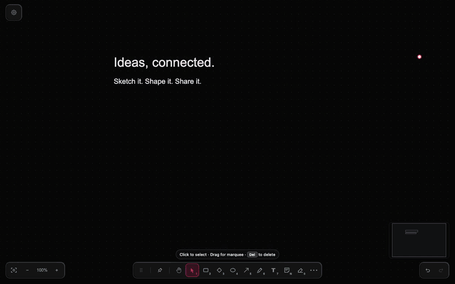

<div align="center">


<h1>MARKASSO</h1>

<p>is a zero-latency, framework-agnostic whiteboard engine. Built with vanilla TypeScript and the Canvas 2D API, it delivers a high-performance drawing experience with a zero-dependency core and a keyboard-first workflow. It’s the "Vesper" of whiteboards: dark, fast, and focused.</p>

<p>
  <a href="assets/markasso-demo.mp4">
    
  </a>
  <br/>
  <a href="assets/markasso-demo.mp4">Watch the 24-second demo</a>
</p>

<a href="https://markasso.it">
  
</a>

<br/><br/>


<br/>

[User Manual](./MANUAL.md) · [Guide](./GUIDA.md) · [MCP for AI agents](./mcp/README.md) · [Architecture](./ARCHITECTURE.md) · [Contributing](./CONTRIBUTORS.md) · [Report an Issue](https://github.com/AlbertoBarrago/markasso/issues)

</div>

---

## Draw with AI agents (MCP)

Markasso ships an [MCP](https://modelcontextprotocol.io) server: Claude, Codex, Gemini and local models (e.g. Gemma in LM Studio) can create, read and edit diagrams, and even draw live on a shared board.

**1. Connect your agent** (Node 22+):

```bash
# Claude Code
claude mcp add markasso -- npx -y @markasso/mcp@latest

# Codex CLI
codex mcp add markasso -- npx -y @markasso/mcp@latest
```

Claude Desktop, Gemini CLI and LM Studio use the same `npx -y @markasso/mcp@latest` command in their `mcpServers` config: see [`mcp/README.md`](mcp/README.md) for every client, the tool list, building from source and the security notes.

**2. Ask for a diagram**, for example: *"Draw the architecture of a checkout service with icons, lay it out left to right and give me a share link"*. For live mode, start a session with **⋯ More tools → Start live session** in Markasso, then **⋯ More tools → Invite AI agent** copies a prompt that brings the agent onto the board. **Menu → Connect AI agent** shows the setup for every client.

---

## Project Status

Markasso is **feature-complete**. Active development of new features is paused. The tool does what it was designed to do. Bug fixes, performance improvements, and small refinements are welcome. Large feature PRs are unlikely to be merged; open an issue first to discuss.

---

## Why Markasso

Excalidraw excels at freehand sketching and draw.io at comprehensive diagramming. **Markasso occupies a different niche**: smaller, faster, keyboard-first, with no sign-in, cookies or workspace to create. This repository is the source of truth for the production deployment.

It started as a game: a project small enough to finish and complex enough to be honest, to stay sharp with LLMs by actually using them. A whiteboard from scratch, vanilla TypeScript, zero dependencies. It didn't stay small. Colleagues started using it, then remote teammates, then people I've never met, to sketch ideas, run retrospectives and think out loud together.

The core (scene, reducer, renderer, tools) stays dependency-free. A dependency is fine only for an isolated, lazy-loaded feature where building it ourselves would mean re-solving someone else's solved problem, worse: Mermaid import runs on [`@excalidraw/mermaid-to-excalidraw`](https://github.com/excalidraw/mermaid-to-excalidraw) and costs nothing until first use.

---

## Features

- **Drawing**: rectangle, rhombus, ellipse, lines with UML-ready arrowheads, curves, freehand pen with stylus pressure, text, sticky notes, shape and connector labels
- **Smart connections**: arrows attach to shape borders and ports, follow moves, resizes and rotations, with elbow routing
- **Diagram libraries**: flowchart shapes, generic architecture icons, the Kubernetes icon set, and official AWS, Azure and Google Cloud packs imported from their ZIP (kept local, never redistributed)
- **Realtime collaboration**: live sessions over a Cloudflare Durable Object, with remote cursors and shared undo
- **AI agents**: an MCP server lets agents build diagrams or draw live on a shared board (see above)
- **Import & export**: `.markasso` files, Mermaid (flowchart, sequence, class, state, ER as native elements), images, PNG, SVG, standalone HTML, share links encoded in the URL
- **Keyboard-first**: command palette (`Ctrl+K`), element search (`Ctrl+F`), one-key tools, hide all panels with `\`
- **Canvas**: infinite pan and zoom, dot, line and millimeter grids, minimap, dark and light themes, auto-save to `localStorage`

Every tool, option and shortcut is documented in the [User Manual](./MANUAL.md) (see the [keyboard shortcut reference](./MANUAL.md#keyboard-shortcut-reference)).

---

## Getting Started

### Install

```bash
pnpm install
```

### Develop

```bash
pnpm dev        # Start dev server at http://localhost:5173
```

### Build & Test

```bash
pnpm build      # Type-check and bundle into dist/
pnpm typecheck  # TypeScript validation
pnpm test       # Run Vitest unit tests
pnpm mcp:build  # Build the MCP server → mcp/dist/markasso-mcp.js
```

No `.env` files. No API keys. No containerization required. Cloud boards and licensing are off in local builds (`VITE_CLOUD_ENABLED`).

`pnpm coverage` runs the suite and updates the coverage badge. UI and rendering modules need a browser and are excluded from Node tests by design. How the code is organized is described in [ARCHITECTURE.md](./ARCHITECTURE.md).

---

## Contributing

See [CONTRIBUTORS.md](./CONTRIBUTORS.md) for guidelines.

## License

MIT · © 2026 Alberto Barrago. Bundled third-party material (Kubernetes icons, Apache-2.0) is listed in [THIRD_PARTY_NOTICES.md](./THIRD_PARTY_NOTICES.md).

_Draw things. Ship things. Touch grass._
